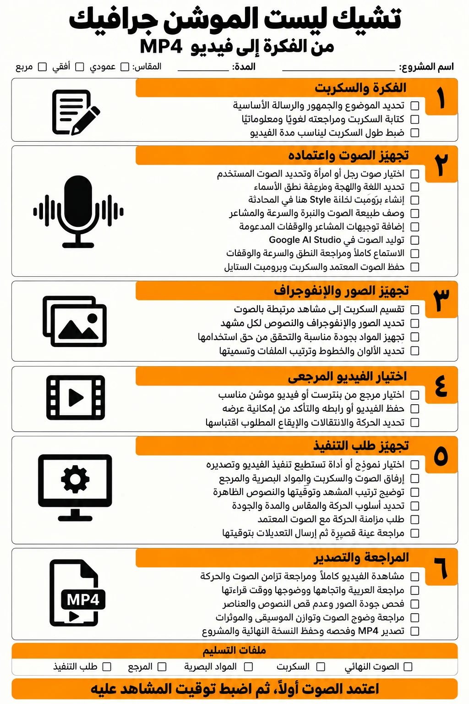

# arabic-motion «موشن عربي»

**إعداد: د. محمد رفعت** · [nre-edu](https://github.com/nre-edu)

<!-- foundry:install:start -->
> **AI agents / وكلاء الذكاء الاصطناعي:** to install, read [INSTALL.md](https://raw.githubusercontent.com/nre-edu/arabic-motion/main/INSTALL.md) and follow the path for your environment.

## Install | التثبيت

**Easiest | الأسهل:** give this repository's link to your AI tool and ask it to install the skill. It will read [INSTALL.md](INSTALL.md).
أعطِ رابط هذا المستودع لأداة الذكاء الاصطناعي التي تستخدمها واطلب منها تثبيت المهارة، وستتبع ملف INSTALL.md.

| Your tool | What to do |
|---|---|
| Claude Code | Ask it to install from this link, or copy `skills/arabic-motion/` to `~/.claude/skills/` |
| Claude.ai / ChatGPT skills | Upload the zip below in the app's skills settings. If its safety scan rejects code, use the zip without code |
| ChatGPT / Gemini / others | Add the single-file text to a custom GPT, Gem, project or custom instructions |
| Your own app / API | Use the single-file text as the system prompt |

- `arabic-motion`: [zip](https://raw.githubusercontent.com/nre-edu/arabic-motion/main/install/arabic-motion.zip) · [zip without code](https://raw.githubusercontent.com/nre-edu/arabic-motion/main/install/arabic-motion-text-only.zip) · [single file](https://raw.githubusercontent.com/nre-edu/arabic-motion/main/install/arabic-motion.md)
<!-- foundry:install:end -->

مهارة لوكلاء الذكاء الاصطناعي (مثل Claude Code) تركّب فيديو موشن جرافيك عربي من ملفاتك أنت: السكربت، والصوت، والصور، ومرجع تريد أسلوبًا مثله: فيديو، أو إنفوجراف، أو صورة من Pinterest.

**أنت تصنع المحتوى، والمهارة ترشدك وتركّب.** لمستك الشخصية تبقى في النص والصوت والصور، ودور المهارة التنظيم والتوقيت والحركة والإخراج.

التشيك ليست أعلاه مدمجة في المهارة، وكل بند فيها مربوط بخطوة أو ملف: [`references/checklist.md`](skills/arabic-motion/references/checklist.md).

## كيف تعمل
1. **ترشدك:** تنشئ مجلد المشروع وتخبرك بما تضعه في كل مكان.
2. **تفحص ملفاتك:** تنبهك للناقص قبل أي عمل.
3. **تحلل المرجع:** إيقاعه، وطول لقطاته، وألوانه، وتكوينه، وانتقالاته، ثم تكتب «بطاقة أسلوب» توافق عليها.
4. **توقّت على صوتك:** تجد بداية كل جملة في ملف الصوت.
5. **تربط الصور بالمقاطع:** تحترم ربطك إن كتبته، وتكمل الباقي حسب إيقاع المرجع، وتعرضه عليك.
6. **تركّب وتخرج:** تحرّك صورك ونصوصك بأسلوب المرجع، وتضيف المؤثرات، وتخرج MP4.

ثلاث مراجعات فقط: بطاقة الأسلوب والربط، ثم لقطات ثابتة، ثم الفيديو كاملًا بالصوت.

## ما تجهزه
| المجلد | المحتوى |
|---|---|
| `script.md` | نفس نص الصوت، سطر مرقّم لكل مقطع، بتاجات الصوت `[excited]`، واختياريًا `{صورة 2}` و`{على الشاشة: ...}` |
| `voice/` | ملف التعليق الصوتي (من Google AI Studio أو أي أداة)، مع وقفة قصيرة بين المقاطع |
| `images/` | الصور والإنفوجراف، مرقّمة: `1.png`، `02-chart.jpg` |
| `reference/` | المرجع: فيديو، أو إنفوجراف، أو صورة (من Pinterest مثلًا)، أو أكثر من ملف |
| `sfx/` | مؤثراتك الصوتية (اختياري) |

واختياريًا: `request.md` (المقاس والمدة والجودة)، و`brand.md` (ألوانك وخطوطك)، و`reference/notes.md` (ما تأخذه من المرجع)، و`voice/style-prompt.md` (برومبت نبرة الصوت).

الدليل الكامل: [`skills/arabic-motion/references/inputs.md`](skills/arabic-motion/references/inputs.md).

## في ChatGPT وGemini
هناك تعمل المهارة مرشدًا فقط، لأن الإخراج يحتاج ملفات وأوامر على جهازك. الخطوات ونص تعليمات مختصر جاهز للـ GPT أو الـ Gem في [`docs/chat-assistants.md`](docs/chat-assistants.md).

## العربية أولًا
- النص يتحرك كلمة كلمة، فلا تتقطع الحروف أبدًا.
- الدخول والأقنعة من اليمين، والكلمات الإنجليزية داخل الجملة العربية بترتيبها الصحيح.
- النقاط والذيول لا تُقص، وخطوط عربية مجانية (OFL) تُنزَّل مع رخصها.

## المتطلبات
- وكيل بصلاحية ملفات وأوامر، مثل **Claude Code**.
- Python 3.9+، وNode.js 18+، وFFmpeg، وPlaywright مع Chromium. المهارة تفحصها، ولا تثبّت شيئًا إلا بإذنك.

## الأمان والخصوصية
- لا تنزّل المهارة أي شيفرة ولا تنفذها. الشبكة تُستعمل فقط لتنزيل خطوط من مستودع Google Fonts الرسمي، ومؤثرات من Openverse، وبطلبك.
- أدوات النظام (FFmpeg، وNode.js، وChromium) تُثبَّت من مديري الحزم الرسميين، وبعد موافقتك فقط.
- ملفاتك تبقى على جهازك ولا تُرسل لأي خدمة، ولا تنزّل المهارة فيديوهات من منصات التواصل.
- لا مفاتيح ولا حسابات مطلوبة.
- للمنصات التي ترفض الحزم التي فيها كود: [`install/arabic-motion-text-only.zip`](install/arabic-motion-text-only.zip).

## حالة التحقق
| الجزء | الحالة |
|---|---|
| المدقق البنيوي (skill-foundry `validate --strict`) | ناجح، 2026-10-28 |
| فحص الملفات وتحليل السكربت والتاجات | مُختبر على ملفات تجريبية، 2026-10-28 |
| ربط الصور بالمقاطع | مُختبر على 4 حالات، 2026-10-28 |
| رسم الإطارات والنص العربي | مُختبر في Chromium، 2026-10-28 |
| تنزيل الخطوط وتوليد المؤثرات محليًا | مُختبر، 2026-10-28 |
| تحليل مرجع فيديو | مُختبر: اكتشف القطعات المعروفة بدقة (2.0، 5.0، 6.5 ث)، 2026-10-28 |
| مشروع حقيقي كامل | فيديو تعليمي 60 ث بصوت مصري من Google AI Studio وإنفوجراف قُصّ إلى 6 بطاقات ومرجع فيديو، 2026-10-28 |
| تحليل مرجع صورة | مُختبر: استخرج ألوان التصميم بدقة، 2026-10-28 |
| توقيت الصوت | مُختبر على تعليق إنجليزي من 5 جمل: كل الحدود صحيحة بفارق نحو 0.1 ث. **التعليق العربي لم يُختبر بعد** |
| إخراج MP4 والخلط | مُختبر: 1080×1920، H.264 + AAC، علو −14 LUFS وذروة −1.9 dBTP، والصوت في موضعه، 2026-10-28 (Windows 11، FFmpeg 9.0.2، Playwright 1.63.0) |
| تنزيل المؤثرات من Openverse | مُختبر: بحث وتنزيل CC0 مع سجل المصدر، 2026-10-28. الخدمة تتأخر أحيانًا في الاستعلامات الجديدة |
| macOS وLinux | غير مُتحقَّق |
| الإرشاد في ChatGPT وGemini | غير مُتحقَّق |
| العمل في أدوات غير Claude Code | غير مُتحقَّق |

## الرخصة
MIT © 2026 د. محمد رفعت (nre-edu). نص الرخصة في [`LICENSE`](LICENSE)، ونسخة منه داخل مجلد المهارة لترافق كل حزمة. الخطوط والمؤثرات المنزَّلة تبقى برخصها الخاصة، ويُحفظ مصدر كل منها في المشروع. أصول المرجع (صوره وموسيقاه ورسومه) لا تُستعمل؛ يُؤخذ منه الأسلوب فقط.
